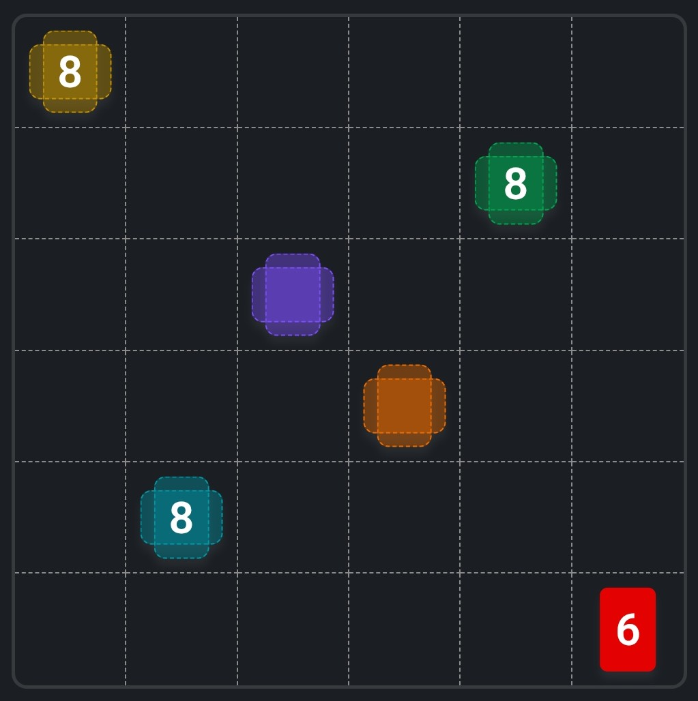
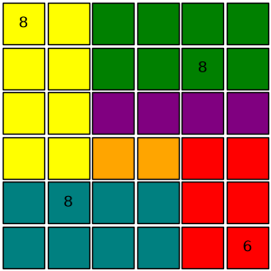

<div id="logo" align="center">
    
</div>

<div id="project-metadata" align="center">
    <a href="https://pypi.org/project/linkedin-games/">
        
    </a>
    <a href="https://pypi.org/project/linkedin-games/">
        
    </a>
    <a href="https://linkedin-games-linear-optimization-solvers.readthedocs.io/">
        
    </a>
    <a href="https://spdx.org/licenses/">
        
    </a>
</div>

# LinkedIn Games

This is the documentation for LinkedIn Games Python package. This package provides a simple set of components to solve LinkedIn board games ([Queens][linkedin-queens], [Tango][linkedin-tango], [Zip][linkedin-zip], [Mini Sudoku][linkedin-mini-sudoku] and [Patches][linkedin-patches] for now) using Linear Optimization models.

# How to Install

To install the LinkedIn Games library, you can use the `pip` command:

```bash
pip install linkedin-games
```

Or run the command below if you use `uv` as your package manager:

```bash
uv add linkedin-games
```

# A Simple Example

In order to solve this Patches game:

<div align="center">
    
</div>

One can run this simple code snippet.

```python
from linkedin_games import Patches

patch_seeds = {
    (1,1): {"color": "yellow", "area": 8},
    (2,5): {"color": "green",  "area": 8},
    (3,3): {"color": "purple"},
    (4,4): {"color": "orange"},
    (5,2): {"color": "teal",   "area": 8},
    (6,6): {"color": "red",    "area": 6, "shape": "vertical"},
}
patches = Patches(size=6, seeds=patch_seeds)
patches.solve().display()
```

Which will return the following result:

<div align="center">
    
</div>

Which, by its turn, matches the official solution of this game:

<div align="center">
    
</div>

# 📙 Textbook

You can read more about the usage and implementation of this package on this [Jupyter Book][textbook].

# 🧩 Play with Code Examples

You can run the code examples of this package on this [JupyterLab environment][playground] (hosted on [Binder]) without installing anything on your machine.

# ❤️ Consider Donating

If you find this library useful and would like to support its development, please consider making a [donation]. Your contributions will help me maintain my work, as well as fund future projects.

[Binder]: https://mybinder.org/
[donation]: https://github.com/sponsors/rodrigo-cl-porto
[linkedin-queens]: https://www.linkedin.com/games/queens/
[linkedin-tango]: https://www.linkedin.com/games/tango/
[linkedin-zip]: https://www.linkedin.com/games/zip/
[linkedin-mini-sudoku]: https://www.linkedin.com/games/mini-sudoku/
[linkedin-patches]: https://www.linkedin.com/games/patches/
[playground]: https://mybinder.org/v2/gh/rodrigo-cl-porto/LinkedIn-Games-Linear-Optimization-Solvers/binder?urlpath=lab%2Ftree%2Fnotebooks%2F
[textbook]: https://rodrigo-cl-porto.github.io/LinkedIn-Games-Linear-Optimization-Solvers/
